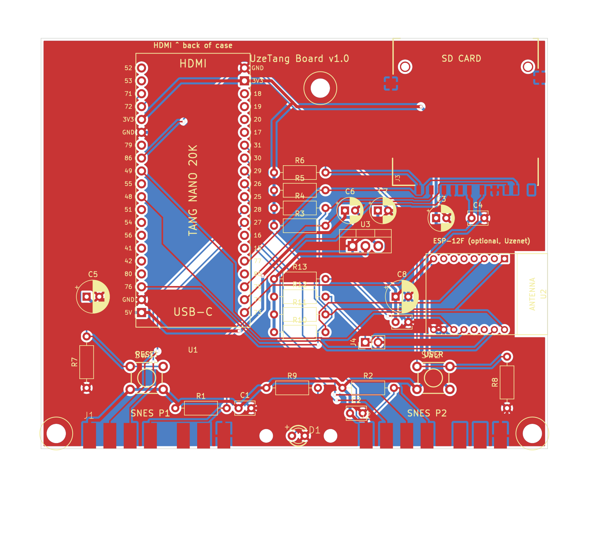

# UzeTang Board v1.0

A carrier PCB that turns a Sipeed **Tang Nano 20K** into a boxed console for
[UzeTang](https://github.com/danboid/UzeTang) and SNESTang, in the
[Uzebox 3D-printed case](https://github.com/Uzebox/uzebox/tree/master/cad/Enclosures/Uzebox/V2.0).



- **Same outline and holes as the Uzebox V5.0 / Omega board:** 100 × 81 mm,
  M3 holes at (3, 3), (97, 3) and (55.14, 71.15), the two light-pipe holes and
  the four rubber-foot positions.
- **Same front panel:** both SNES sockets, the RESET and USER buttons and the
  power LED sit exactly where the Uzebox has them, so the case's button caps
  and light pipe line up.
- **Same SD socket in the same place** (Würth 693063020911 at (83.82, 52.07),
  card in from the back), wired with all six SD lines so SNESTang can use 4-bit
  SD mode as well as UzeTang's SPI mode.
- **Tang Nano 20K on two 1×20 female headers**, rotated so that its **HDMI
  socket faces the back of the case** (it overhangs the rear edge by about
  2 mm). Its USB-C faces the front, inside the case: use a short USB-C
  extension with a panel-mount end in the rear wall for power and flashing.
- **Removable ESP-12F** (Uzenet) on two 8-pin 2 mm receptacles, as on the
  Uzebox, with its own LD1117V33 regulator fed from the Tang's 5 V. The whole
  ESP section is optional.
- Everything is through-hole except the SD socket (the same SMD socket the
  Uzebox uses). Two-layer board, GND poured on both sides.

Coordinates in this file are Uzebox V5.0 board coordinates: mm from the
front-left corner, y towards the back.

## Files

| File | What it is |
|---|---|
| `UzeTang-Board.kicad_pro` / `.kicad_pcb` / `.kicad_sch` | KiCad 7 project (opens in KiCad 7 and later) |
| `UzeTang-Board.pretty/`, `UzeTang-Board.kicad_sym` | Project footprint and symbol libraries (referenced by `fp-lib-table` / `sym-lib-table`) |
| `UzeTang-Board.kicad_dru` | Custom design rules (see *DRC* below) |
| `bom/UzeTang-Board-BOM-DigiKey.xlsx` | Digi-Key BOM; set the number of boards in F3 |
| `gerbers/` | Gerbers and drill file, ready to upload to a PCB fab |
| `docs/` | Renders of the copper layers, silkscreen and schematic |
| `gen/` | Scripts that generate everything (see *Regenerating*) |

## Pin assignments

| Function | Tang Nano 20K pin | Notes |
|---|---|---|
| SNES P1 latch / clock / data | 28 / 27 / 25 | Same as SNESTang and UzeTang; 4.7k pull-up on data |
| SNES P2 latch / clock / data | 29 / 26 / 30 | Same as SNESTang and UzeTang; 4.7k pull-up on data |
| SD CLK / CMD / DAT0 / DAT1 / DAT2 / DAT3 | 73 / 74 / 75 / 77 / 86 / 76 | 10k pull-ups on DAT0-DAT3 |
| RESET button | 71 | Active high, 10k pull-down (like the Tang's S1) |
| USER button | 72 | Active high, 10k pull-down (like the Tang's S2) |
| ESP-12F RXD (FPGA TX) / TXD (FPGA RX) | 48 / 49 | |
| ESP-12F RST | 31 | Also pulled up to the ESP's 3.3 V |
| Power LED | - | From the Tang's 3.3 V through 330 Ω |

SNES pads and the SD card run from the Tang's 3.3 V pins. Pins 80 and 85 are
deliberately left unconnected: on the Tang Nano 20K they are shared with its
own micro SD slot. All other free header pins are unused.

## Firmware changes

The SNES pads need no changes. The buttons and SD card use different pins from
the bare Tang Nano 20K, so the bitstreams need a board constraint file:

- **UzeTang:** `rtl/tang20k/uzetang_board.cst` holds the board's pins. Build
  with `CST=uzetang_board.cst syn/oss_build.sh` (open-source tools) or
  `UZETANG_CST=uzetang_board.cst gw_sh build.tcl` (Gowin). The default build
  still targets a bare Tang Nano 20K.
- **SNESTang:** in `nano20k.cst`, move the two buttons to 71 / 72 and the SD
  lines to the pins in the table above. Both stay active high, as on the
  Tang's own buttons.

## Building one

1. Order the PCB from the files in `gerbers/` (2 layers, 1.6 mm, any colour).
2. Solder the SD socket first (it is the only SMD part), then the low parts:
   resistors, ceramic capacitors, LED, buttons, then the taller parts.
3. Fit the two 1×20 female headers for the Tang Nano 20K. Plug the Tang in
   while soldering them so they stay straight. Mind the orientation: the
   silkscreen shows where the HDMI and USB-C ends go, and the HDMI end goes to
   the back edge.
4. The SNES sockets solder to pads on the front edge, as on the Uzebox.
5. ESP-12F (optional): solder the 2 mm male headers to the module, and the two
   2 mm receptacles, the LD1117V33, C6-C9, R10-R13 and J4 to the board. Fit the
   J4 jumper to boot the ESP-12F into flash mode.

### Fitting the case

The case's back wall was built for the Uzebox's DC jack, S-video and RCA
jacks, which this board does not have. Cut or redesign the rear openings for:

- the Tang Nano 20K's **HDMI socket**, centred about 30 mm from the board's
  left edge. Its height depends on the headers: with standard 8.5 mm female
  headers the Tang's PCB sits about 11 mm above this board, and the HDMI
  socket is on top of it. Measure your assembled board before modelling the
  opening.
- a panel-mount **USB-C** extension (the Tang's USB-C faces the front inside
  the case).

The SD card slot and all the front-panel openings stay as they are. There is
about 22 mm of headroom above the PCB, enough for the Tang on 8.5 mm headers.

## DRC

Run DRC in KiCad's PCB editor. Expected results:

- No unconnected items and no clearance errors.
- **Silkscreen warnings** where the back-side text crosses tracks: harmless.
- The SNES socket pads reach the front edge, exactly as on the Uzebox board.
  A rule in `UzeTang-Board.kicad_dru` sets the edge-clearance check to
  *ignore* for J1 and J2, which KiCad 10 honours. The KiCad 7 Python DRC in
  `gen/drc.py` still lists those 14 pads.

## Regenerating

The board, schematic and BOM are generated from `gen/design.py`, which holds
the part list, positions and nets. You can edit the KiCad files by hand, or
change `design.py` and regenerate:

```sh
# KiCad 7 (pcbnew Python module), Java 17+, Freerouting 1.9 and xvfb-run
python3 gen/make_footprints.py <uzebox-omega>/.../Uzebox_Omega.pretty UzeTang-Board.pretty  # only if footprints change
FREEROUTING=/path/to/freerouting.jar gen/route.sh   # place, autoroute, pour GND, DRC, schematic
python3 gen/check_netlist.py                       # schematic netlist == board netlist
python3 gen/make_bom.py                             # Digi-Key BOM
```

`route.sh` retries the autorouter until DRC reports no unconnected items.
`design.PREROUTES` holds one hand-placed +3V3 track that Freerouting keeps.

## Licence

CERN-OHL-S-2.0. The SNES, tactile switch, SD socket and LED footprints come
from the Uzebox Omega v1.5 KiCad project; the Tang Nano 20K pinout comes from
the MiSTeryShield20k project.
